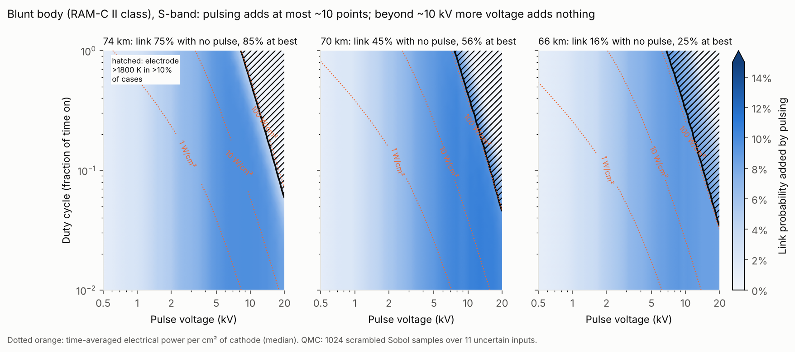
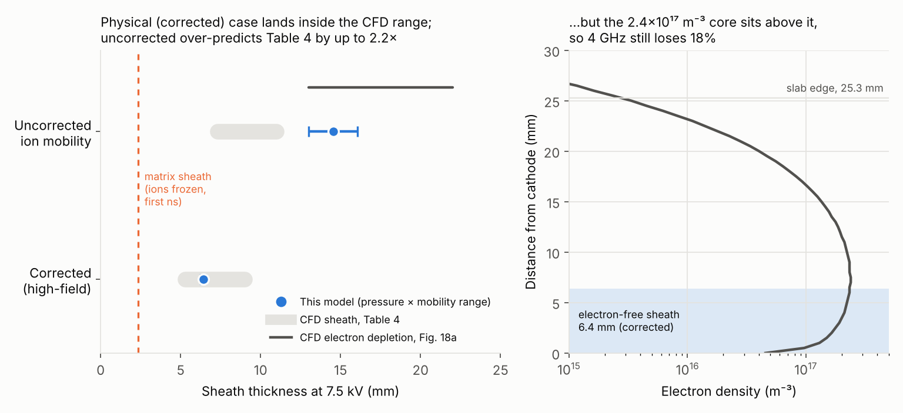
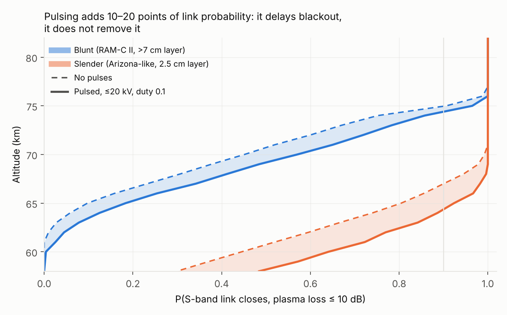
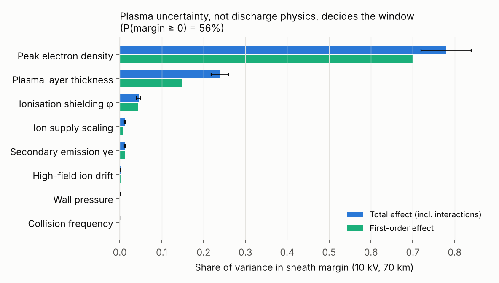
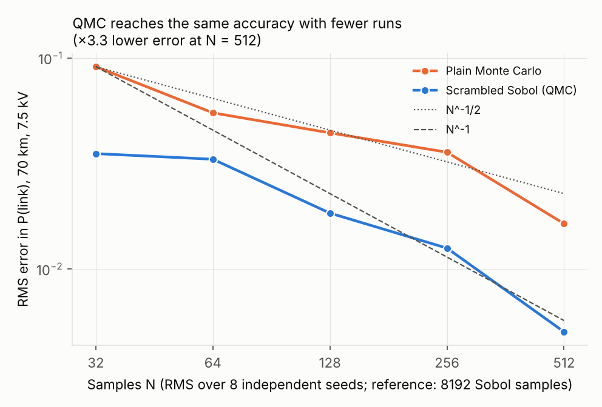

# Re-entry Blackout Window

**Where, at what cost, and with what confidence can pulsed electric fields restore radio contact through a re-entry plasma?**

> **Summary:** pulsing buys about 1.5–2.5 km of extra S-band link altitude for about 290 W of average power. The limit is the depth of the plasma layer, not heating or arcing, and the biggest uncertainty is the re-entry plasma density itself, not the discharge physics. The reduced-order model is validated to within 3.7% against coupled CFD, has 33 tests and runs in seconds per flight condition.

During re-entry the shock layer ionises and blocks radio links, known as a "blackout". A large negative voltage pulse on a surface electrode can push electrons out of a region above an antenna and open a window. Recent coupled CFD by Rodríguez Fuentes & Parent (2026, University of Arizona; called "Arizona" below) showed this at one flight condition. Particle simulations by Krishnamoorthy & Close (2017) showed it in collisionless plasma over nanoseconds. This project builds a fast reduced-order model, validates it against that CFD and against the RAM-C II flight data, and maps the whole design space with quasi-Monte Carlo uncertainty quantification.


*Probability that the link closes within heating, arcing and power limits, over pulse voltage and duty cycle, at 74, 70 and 66 km. Hatched: electrode above 1800 K in more than 10% of cases (heating-limited, roughly above 100 W/cm² average power).*

## Findings

**Definitions used below**
- **Link probability:** the fraction of quasi-Monte Carlo samples over the uncertain inputs (table below) in which the electron-free sheath is at least as deep as needed to keep one-way plasma loss at 2.25 GHz (S-band) at or below 10 dB.
- **Link window:** the sheath only exists while the pulse is on. It forms in about 0.1 µs and collapses in about 20 ns, so at duty cycle *D* the link is open for about a fraction *D* of the time. This assumes **burst transmission synchronised with the pulses**, not a continuous link.

**Results**
- **Pulsing delays blackout; it does not remove it.** For a blunt RAM-C II-class body at S-band, pulses add at most 13 percentage points of link probability, moving the 50% link altitude from 70.7 to 69.2 km. For a slender body with a thin plasma layer they add up to 20 points, moving the same point from 60.7 to 58.2 km.
- **Depth, not heat or power, is the limit.** The electron-free sheath reaches 5–15 mm, but at the blackout peak the overdense layer is several centimetres thick.
  - At 70 km and 7.5 kV, the cathode adds 11 W/cm² of heating to 15 W/cm² of aerodynamic heating. Even with the pulse always on, the electrode reaches about 1530 K, below the 1800 K electrode and insulator limit used in the model. At a 5% duty cycle it reaches about 1350 K.
  - The current is 200× below the glow-to-arc threshold.
  - Heating only becomes the limiting constraint above about 100 W/cm² of average electrical power (hatched region in the maps).
- **More voltage stops helping beyond about 10 kV.** The cathode current rises roughly as V², so ionisation inside the sheath adds shielding as fast as voltage adds depth. How strongly depends on what share of the ions created in the sheath shield it (φ). This is the main physics unknown, and the current scaling is extrapolated above the 7.5 kV calibration point.
- **What decides the window is the plasma, not the discharge.** The Sobol analysis covers sheath margin (sheath depth minus required depth) at 70 km and 10 kV, over the 8 inputs that affect the link.
  - Total-order indices: peak electron density 0.78, layer thickness 0.24.
  - First-order indices: 0.70 and 0.15. The gap between first-order and total-order is the interaction between density and thickness, which is why the total-order indices add up to more than 1.
  - All discharge inputs together have total-order indices of about 0.07: ionisation shielding φ 0.05, secondary emission and ion supply about 0.01 each.
  - Better re-entry plasma prediction matters more than better discharge modelling.
- **The cost is small.** Nominally at 70 km, 7.5 kV with a 5% duty cycle averages 5.9 W per cm² of cathode. That is about 290 W for a 50 cm² electrode, or a few Wh over a RAM-C II-length blackout.

## Method

Each flight condition evaluates in seconds. A single 10,000-sample sensitivity study takes about a minute, and the full analysis suite about 8 minutes on a laptop.

| Module | Physics | File |
|---|---|---|
| Plasma and propagation | Cold collisional plasma; exact 1D multilayer transfer matrix (includes reflection) | `plasma.py`, `propagation.py` |
| Sheath | Matrix sheath; steady collisional sheath with high-field ion drift v = K√(E/N), integrated exactly over the real gas-density profile (matches the ODE solver to 0.01%) | `sheath.py` |
| Current closure | J = c_s·e·n₀·u_B·[1 + g(γe)(V/V_m)^m], calibrated on the Arizona I–V curve (2.9% RMS); γe dependence from their Fig. 18b | `closure.py` |
| Flight condition | US76 atmosphere, RAM-C II trajectory, station-3 peak density, Arizona profile shape stretched to the RAM-C aft layer (>7 cm) | `atmosphere.py`, `window.py` |
| Limits | Electrode radiative-equilibrium temperature (aerodynamic heating + ion impact at Wannier energy + neutralisation) against an 1800 K electrode and insulator limit; glow-to-arc current density; average power | `window.py` |
| Uncertainty | Scrambled Sobol sequences over all 11 inputs for the feasibility maps and trajectory; Sobol indices over the 8 link inputs (first-order Saltelli 2010, total-order Jansen) with bootstrap intervals | `uq.py`, `analysis/` |

Quasi-steady square pulses are justified by the timescales at 70 km. The sheath forms in about 0.1 µs (ion transit) and settles within the 10 µs flow residence time. It collapses in about 20 ns when electrons return. Pulses longer than about 50 µs therefore give a window lasting the whole pulse.

### Uncertain inputs (uniform ranges)

| Input | Range | Basis |
|---|---|---|
| Peak electron density | ×0.5–2 | RAM-C II reflectometer error bar |
| Layer thickness | 2–4× Arizona shape (5–10 cm) | RAM-C II probe rake: aft layer >7 cm |
| Wall pressure coefficient | 0.04–0.08 | 9° cone, hypersonic |
| High-field ion drift constant | ±20% | Sinnott et al. data scatter |
| Secondary emission γe | 0.1–0.5 | Arizona sensitivity range |
| Ion supply scaling c_s | ×0.5–1.5 | Single calibration point |
| Ionisation shielding φ | 0–1 | Bounds: Arizona 5→7.5 kV growth sits between |
| Collision cross-section | ×0.5–2 | Hard-sphere estimate |
| Ion energy accommodation | 0.25–1 | Wannier energy, surface physics |
| Aft/stagnation heating ratio | 0.05–0.12 | Laminar cone distributions |
| Glow-to-arc current density | 10⁴–10⁵ A/m² | Glow discharge literature |

The first 8 inputs affect the link. The last 3 affect only heating and arcing.

## Validation

| Case | Source | Result |
|---|---|---|
| V1 plasma layer | RAM-C II, NASA TN D-6062 | **Partial.** Data rebuilt; altitudes cross-checked to 0.34 km. Modelled S-band blackout onset ≈71 km vs reflectometer cut-off at 74 km: the model starts blackout about 3 km late, so it underpredicts density near onset and is optimistic there (see Limitations) |
| V2 attenuation | Arizona 2026, Table 4 | **Pass**: 6 points within 3.7% |
| V3 sheath and window | Arizona 2026, 7.5 kV | **Pass**: sheath 6.1–6.6 mm vs CFD 5.3–9 mm. The high-field mobility correction shrinks the sheath ×0.44, within the paper's "two- or three-fold". Plasma density above the sheath 1.21×10¹⁷ vs 1.14×10¹⁷ m⁻³ |
| Current closure | Arizona 2026, Fig. 16 | 2.9% RMS; reproduces 7.5 kV current and γe sweep |
| QMC | This work | ×3.3 lower error than plain Monte Carlo at 512 samples |


*V3: modelled sheath thickness at 7.5 kV against the Arizona CFD range, with and without the high-field mobility correction.*

Further results:
- **Arizona's Eq. (18) appears to contain a typo.** As typeset (ω_p⁴), it does not reproduce their own Table 4; the standard ω_p²ω² form does.
- **Averaging the plasma into a uniform slab overstates the window.** Near the plasma frequency, a slab of the same mean density gives 99.9% transmission at 4 GHz where the real profile gives 82%.


*Link probability against altitude along the RAM-C II trajectory, with and without pulses (≤20 kV, duty cycle 0.1), for a blunt RAM-C II body (>7 cm layer) and a slender Arizona-like body (2.5 cm layer).*


*First-order and total-order Sobol indices for sheath margin at 70 km, 10 kV, with bootstrap intervals.*


*Error in link probability against sample count: scrambled Sobol (QMC) against plain Monte Carlo.*

## Limitations

- **One calibration point.** The current closure comes from one CFD condition (68 km, sharp wedge). Scaling with density, temperature and voltage above 7.5 kV is physics-based but unvalidated, so it is carried as uncertainty.
- **Assumed profile shape.** The RAM-C aft profile reuses the Arizona shape stretched to >7 cm, and peak density is interpolated from three reflectometer points. One of them (X-band, 52 km) is low confidence. Dropping it raises densities below 70 km by 2–5×, which would make pulsing less effective, so the findings above are if anything optimistic.
- **Intermittent link.** The window only exists while the pulse is on, so the results assume burst transmission synchronised with the pulses. Data rate, synchronisation and the effect of the pulses on the radio itself are not modelled.
- **Steady-state heating.** Electrode temperature uses steady radiative equilibrium, which is conservative for a short blackout. Gas heating is reported only as an upper bound that ignores heat losses, and is not used as a limit. Edge hot spots seen in the CFD at high γe are not modelled (1D).
- **Single antenna and electrode.** One planar electrode pair; no magnetic field, multi-electrode arrays or insulated-electrode charging (Krishnamoorthy & Close).

## Repository layout

```
src/blackout/     plasma, propagation, sheath, closure, atmosphere, window, uq
data/             RAM-C II tables (build_ramc2.py) and digitised Arizona CFD data (arizona2026/)
validation/       v2_arizona_table4.py, v3_arizona_7p5kV.py
analysis/         run_analysis.py (trajectory, slender, maps, sobol, convergence, costs), make_figures.py
tests/            33 physics, validation and regression tests (unittest; pytest compatible)
figures/          generated plots
```

## Run it

```bash
pip install -r requirements.txt
python data/build_ramc2.py && python data/plot_ramc2.py
python validation/v2_arizona_table4.py && python validation/v3_arizona_7p5kV.py
python analysis/run_analysis.py          # full suite, about 8 minutes on a laptop
python analysis/make_figures.py
python -m unittest discover -s tests     # or: pytest
```

## Key references

1. Rodríguez Fuentes, F. M. & Parent, B. (2026). Electron density depletion in reentry plasma flows using pulsed electric fields. *Physics of Fluids* 38(3), 036114. [arXiv:2512.18163](https://arxiv.org/abs/2512.18163)
2. Krishnamoorthy, S. & Close, S. (2017). Investigation of plasma–surface interaction effects on pulsed electrostatic manipulation for reentry blackout alleviation. *J. Phys. D* 50, 105202. Their particle simulations are collisionless and nanoseconds long. They note that surrogate models and smart sampling are needed to map the design space, which motivated this project.
3. Keidar, M., Kim, M. & Boyd, I. D. (2008). Electromagnetic reduction of plasma density during atmospheric reentry and hypersonic flights. *J. Spacecraft Rockets* 45(3), 445–453.
4. Grantham, W. L. (1970). Flight results of a 25,000 ft/s reentry experiment using microwave reflectometers. NASA TN D-6062. [NTRS](https://ntrs.nasa.gov/citations/19710004000)
5. Saltelli, A. et al. (2010). Variance based sensitivity analysis of model output. *Computer Physics Communications* 181, 259–270.

## Author

Adam Williams, MEng Aeronautical & Astronautical Engineering, University of Southampton (graduating June 2027). October 2026.
Contact: a.ciumei.w@gmail.com

## Licence

MIT. See [LICENSE](LICENSE).
