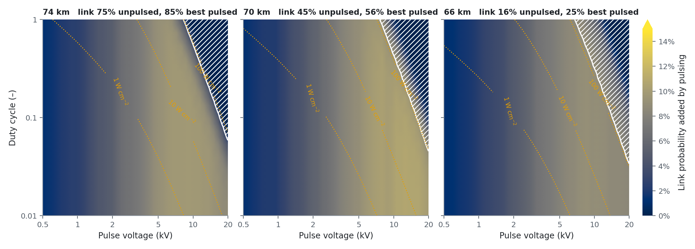
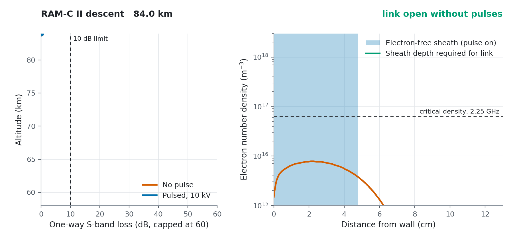
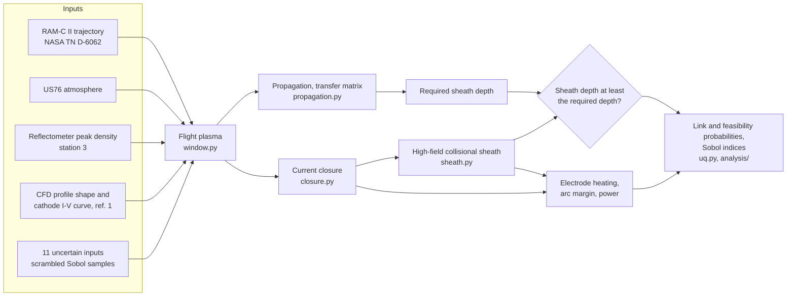
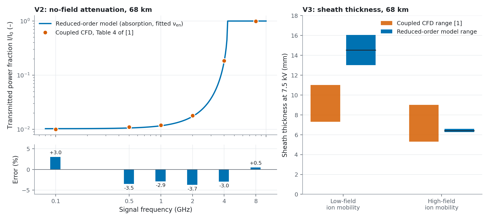
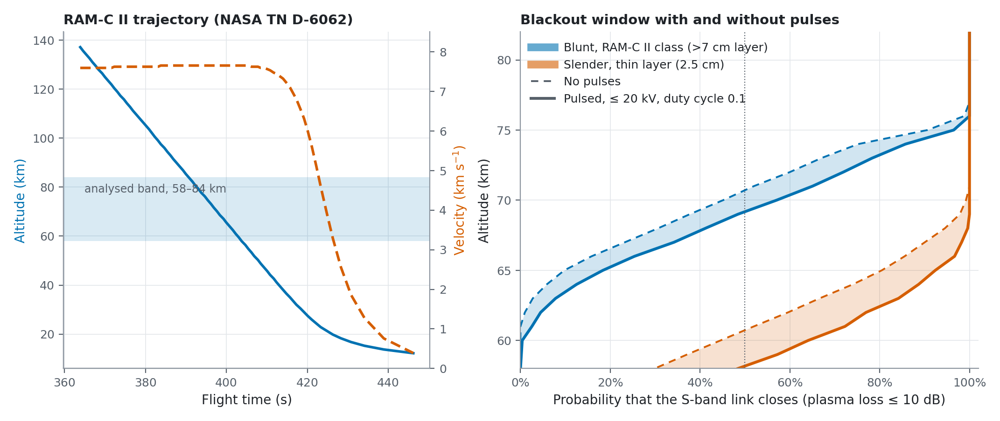
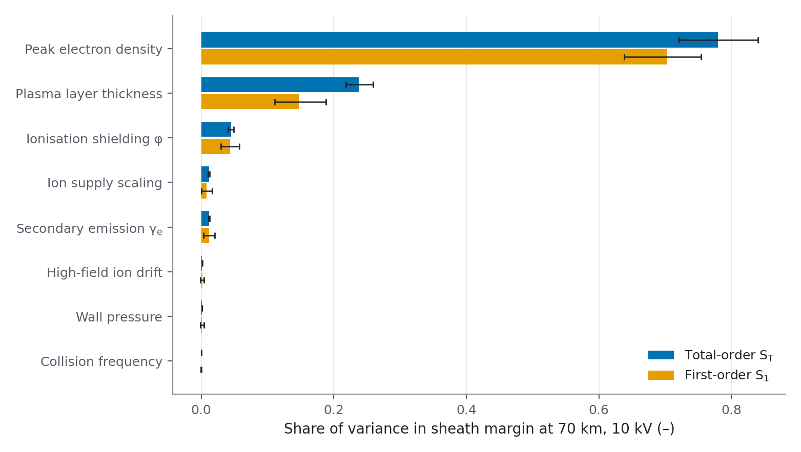
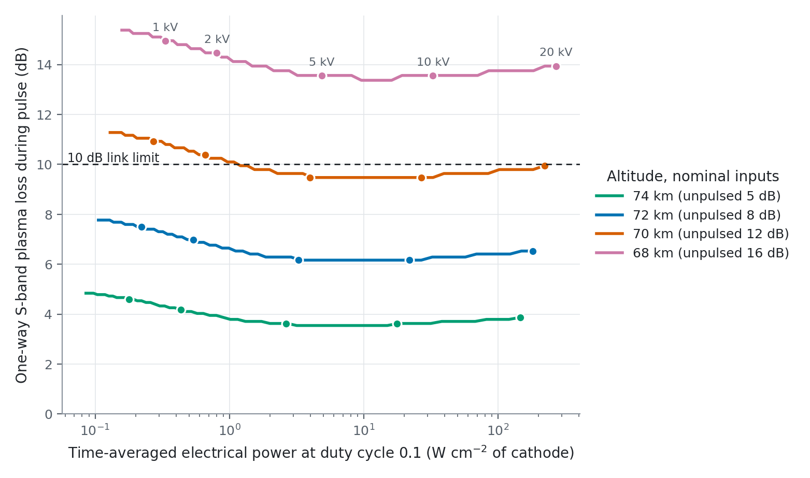
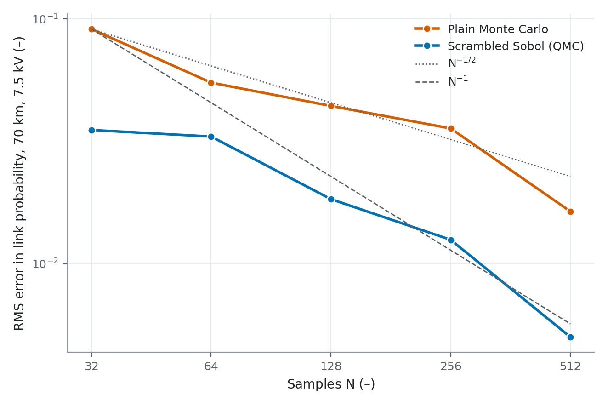

# Re-entry Blackout Window

**A reduced-order model of pulsed electric-field mitigation of re-entry radio blackout along the RAM-C II trajectory, checked against coupled CFD and mapped with quasi-Monte Carlo uncertainty quantification.**


<picture>
  <source media="(prefers-color-scheme: dark)" srcset="docs/assets/hero_feasibility_maps-dark.png">
  
</picture>

*Link probability added by pulsing, over pulse voltage and duty cycle, at 74, 70 and 66 km (blunt RAM-C II-class body, S-band, 1024 scrambled Sobol samples over 11 uncertain inputs). Hatched: electrode above 1800 K in more than 10% of samples. Dotted: median time-averaged electrical power per cm² of cathode.*

<picture>
  <source media="(prefers-color-scheme: dark)" srcset="docs/assets/descent-dark.gif">
  
</picture>

*Descent from 84 to 58 km at nominal inputs. Left: one-way S-band loss with and without a 10 kV pulse. Right: electron density above the antenna, the electron-free sheath the pulse creates, and the sheath depth the link needs.*

## Key results

- **Pulsing delays blackout by 1.5–2.5 km of altitude; it does not remove it.** The 50% link-probability altitude moves from 70.7 to 69.2 km for a blunt RAM-C II-class body and from 60.7 to 58.2 km for a slender body. The largest gain in link probability is 13 and 20 percentage points respectively.
- **The limit is plasma depth, not heating, arcing or power.** At 70 km and 7.5 kV the electrode reaches about 1350 K at a 5% duty cycle (1530 K with the pulse always on) against an 1800 K limit, and the current density is 200 times below the glow-to-arc threshold.
- **The cost is small.** 7.5 kV at a 5% duty cycle averages 5.9 W per cm² of cathode at 70 km, about 290 W for a 50 cm² electrode.
- **The plasma, not the discharge, decides the window.** Total-order Sobol indices for sheath margin at 70 km and 10 kV: peak electron density 0.78, layer thickness 0.24, all discharge inputs together about 0.07.
- **Agreement with coupled CFD.** With one fitted collision frequency the model reproduces the six tabulated attenuation points of Rodríguez Fuentes & Parent [1] to within 3.7%, and predicts a 6.3–6.6 mm sheath at 7.5 kV against a CFD range of 5.3–9 mm.

All probabilities assume **burst transmission synchronised with the pulses**: the sheath exists only while the pulse is on, so at duty cycle $D$ the link is open for about a fraction $D$ of the time.

## Background and motivation

During re-entry the shock layer ionises. Where the electron density exceeds the critical density for the signal frequency, the layer reflects and absorbs radio waves and the link is lost: the "blackout". A large negative voltage pulse on a surface electrode expels electrons from a region above an antenna and can open a window through the layer.

Coupled CFD by Rodríguez Fuentes & Parent [1] demonstrated this at one flight condition (68 km, sharp wedge). Particle simulations by Krishnamoorthy & Close [2] showed it in collisionless plasma over nanoseconds, and noted that surrogate models are needed to explore the design space. This project builds such a model: it evaluates one flight condition in seconds, which makes it possible to ask where along a trajectory pulsing helps, what it costs, and how confident the answer is given how poorly the plasma itself is known.

## Method



### Governing equations

**Plasma and propagation.** The layer is a cold collisional plasma with relative permittivity

$$\varepsilon_r = 1 - \frac{\omega_p^2}{\omega(\omega + i\nu_{en})}, \qquad \omega_p^2 = \frac{n_e e^2}{\varepsilon_0 m_e}, \qquad n_{crit} = \frac{\varepsilon_0 m_e \omega^2}{e^2}$$

The electron density profile is divided into 0.5 mm layers of complex refractive index $n_j = \sqrt{\varepsilon_{r,j}}$ and thickness $d_j$. The transmitted power fraction at normal incidence follows from the product of characteristic matrices, which includes reflection at every interface:

$$M = \prod_j \begin{pmatrix} \cos\delta_j & -\dfrac{i}{n_j}\sin\delta_j \\\\ -i n_j\sin\delta_j & \cos\delta_j \end{pmatrix}, \qquad \delta_j = \frac{\omega}{c} n_j d_j, \qquad T = \left| \frac{2}{M_{11}+M_{12}+M_{21}+M_{22}} \right|^2$$

The **required depth** $d_{req}$ is the smallest electron-free depth from the wall for which the one-way loss $-10\log_{10}T$ at 2.25 GHz is at most 10 dB.

**Sheath.** At reduced fields of thousands of townsend the ion drift velocity saturates as $v_i = K\sqrt{E/N}$ (Sinnott et al., as used in [1]). With a constant ion current density $J$ across the sheath, Poisson's equation integrates exactly over the real gas-density profile $N(y)$:

$$E(s)^{3/2} = \frac{3J}{2\varepsilon_0 K}\int_0^s \sqrt{N}\mathrm{d}s', \qquad V = \int_0^{d_s} E\mathrm{d}s$$

where $s$ is measured from the sheath edge towards the cathode. For uniform gas density this reduces to

$$d_s = \left(\frac{5V}{3}\right)^{3/5}\left(\frac{2\varepsilon_0 K}{3J\sqrt{N}}\right)^{2/5}$$

**Current closure.** The cathode current density is an ion-supply term plus an ionisation term, calibrated on the CFD current–voltage curve of [1] (2.9% RMS):

$$J(V) = J_s\left[1 + g(\gamma_e)\left(\frac{V}{V_m}\right)^m\right], \qquad J_s = c_s e n_0\sqrt{\frac{k_B T}{m_i}}$$

The fit gives $c_s = 0.82$, $V_m = 5.27$ kV and $m = 2.16$. The current that shields the sheath is $J_{eff} = J_s + \varphi(J - J_s)$, where $\varphi \in [0, 1]$ is the uncertain share of sheath-generated ions that contribute to shielding.

**Limits.** A voltage and duty-cycle pair is feasible when the link closes ($d_s \ge d_{req}$), the current density is below the glow-to-arc threshold ($J \le J_{arc}$) and the electrode radiative-equilibrium temperature is below 1800 K:

$$T_w = \left(\frac{q_{aero} + D q_{cathode}}{\epsilon \sigma}\right)^{1/4}$$

Here $q_{aero}$ is a fraction of the Sutton–Graves stagnation heat flux [6] and $q_{cathode}$ is ion impact at the Wannier mean energy plus neutralisation.

**Sensitivity.** Sobol indices use Saltelli sampling matrices $A$, $B$ and $A_B^{(i)}$ with the Saltelli (2010) first-order estimator [5] and the Jansen total-order estimator [7]:

$$S_i = \frac{\frac{1}{n}\sum_k f(B)_k\left[f(A_B^{(i)})_k - f(A)_k\right]}{\mathrm{Var}(f)}, \qquad S_{Ti} = \frac{\frac{1}{2n}\sum_k\left[f(A)_k - f(A_B^{(i)})_k\right]^2}{\mathrm{Var}(f)}$$

### Assumptions

- One-dimensional, wall-normal geometry; plane wave at normal incidence; a single planar electrode pair.
- Quasi-steady square pulses. At 70 km and 7.5 kV the sheath forms in about 0.14 µs (ion transit) and collapses in about 17 ns (electron return), both short against the 10 µs flow residence time.
- The plasma profile above the antenna is the digitised 68 km CFD profile shape of [1], scaled to the RAM-C II station-3 peak density and stretched to the thicker aft layer.
- US Standard Atmosphere 1976 [8]; wall pressure $p_w = p_\infty + C_p q_\infty$.
- Electron–neutral collision frequency from a hard-sphere cross-section, carried as an uncertain input.

### Uncertain inputs (uniform ranges)

| Input | Range | Basis |
|---|---|---|
| Peak electron density | ×0.5–2 | RAM-C II reflectometer error bar |
| Layer thickness | 2–4× CFD profile shape (5–10 cm) | RAM-C II probe rake: aft layer >7 cm |
| Wall pressure coefficient | 0.04–0.08 | 9° cone, hypersonic |
| High-field ion drift constant | ±20% | Sinnott et al. data scatter |
| Secondary emission $\gamma_e$ | 0.1–0.5 | Sensitivity range in [1] |
| Ion supply scaling $c_s$ | ×0.5–1.5 | Single calibration point |
| Ionisation shielding $\varphi$ | 0–1 | Bounds; the 5 to 7.5 kV sheath growth in [1] sits between |
| Collision cross-section | ×0.5–2 | Hard-sphere estimate |
| Ion energy accommodation | 0.25–1 | Wannier energy, surface physics |
| Aft/stagnation heating ratio | 0.05–0.12 | Laminar cone distributions |
| Glow-to-arc current density | 10⁴–10⁵ A/m² | Glow discharge literature |

The first eight inputs affect the link. The last three affect only heating and arcing.

## Validation and verification

<picture>
  <source media="(prefers-color-scheme: dark)" srcset="docs/assets/validation_cfd-dark.png">
  
</picture>

*Left: transmitted power fraction through the no-field plasma slab of [1] (2.31×10¹⁷ m⁻³, 2.53 cm) against their Table 4, with the percentage error at each point. Right: modelled sheath thickness at 7.5 kV against the CFD range, with low-field and high-field ion mobility.*

| Case | Reference | Result |
|---|---|---|
| V1 plasma layer | RAM-C II, NASA TN D-6062 [4] | **Partial.** Altitudes cross-checked to 0.34 km. Modelled S-band blackout onset is about 71 km against a reflectometer cut-off at 74 km, so the model underpredicts density near onset and is optimistic there. |
| V2 attenuation | [1], Table 4 | **Pass.** Six frequencies from 0.1 to 8 GHz within 3.7% (errors +3.0, −3.5, −2.9, −3.7, −3.0, +0.5%). The paper does not state its collision frequency, so a single value is fitted to all six points. |
| V3 sheath and window | [1], 7.5 kV case | **Pass.** Sheath 6.3–6.6 mm against CFD 5.3–9 mm. The high-field mobility correction shrinks the sheath by a factor of 0.44, consistent with the "two- or three-fold" reported in [1]. Plasma density above the sheath 1.21×10¹⁷ against 1.14×10¹⁷ m⁻³. |
| Current closure | [1], Fig. 16 | 2.9% RMS over the digitised current–voltage curve. |
| Sheath solver | This work | Closed-form profile integration agrees with the ODE solver to 0.01%. |
| QMC | This work | 3.3 times lower RMS error than plain Monte Carlo at 512 samples. |
| Regression | This work | 33 unit, validation and regression tests. |

Two further findings from the validation work:

- **Eq. (18) of [1] appears to contain a typographical error.** As typeset (with $\omega_p^4$) it does not reproduce the paper's own Table 4; the standard form with $\omega_p^2\omega^2$ does.
- **Averaging the plasma into a uniform slab overstates the window.** Near the plasma frequency, a slab of the same mean density gives 99.9% transmission at 4 GHz where the transfer matrix over the real profile gives 82%.

## Results gallery

<picture>
  <source media="(prefers-color-scheme: dark)" srcset="docs/assets/trajectory_blackout_window-dark.png">
  
</picture>

*RAM-C II trajectory with the analysed band, and link probability against altitude with and without pulses for a blunt and a slender body (512 samples per altitude).*

<picture>
  <source media="(prefers-color-scheme: dark)" srcset="docs/assets/sobol_indices-dark.png">
  
</picture>

*First-order and total-order Sobol indices for sheath margin (sheath depth minus required depth) at 70 km and 10 kV, with 5–95% bootstrap intervals. The gap between the two for density and thickness is their interaction.*

<picture>
  <source media="(prefers-color-scheme: dark)" srcset="docs/assets/power_attenuation_tradeoff-dark.png">
  
</picture>

*Power against attenuation at nominal inputs: each curve sweeps pulse voltage from 0.5 to 20 kV (markers at 1, 2, 5, 10 and 20 kV). More power buys about 2 dB and stops helping beyond about 10 kV, because the cathode current rises roughly as V² and shields the sheath. Steps reflect the 0.5 mm layer grid.*

<picture>
  <source media="(prefers-color-scheme: dark)" srcset="docs/assets/qmc_convergence-dark.png">
  
</picture>

*RMS error in link probability at 70 km and 7.5 kV against sample count (eight independent seeds; reference: 8192 Sobol samples).*

## Quick start

```bash
git clone https://github.com/adamcw169/Reentry-blackout-window.git
cd Reentry-blackout-window
pip install -r requirements.txt
```

Reproduce every figure and the animation in this README from the committed results (about one minute):

```bash
python scripts/make_figures.py
```

Re-run the underlying analysis and checks:

```bash
python -m unittest discover -s tests       # 33 tests; pytest also works
python validation/v2_arizona_table4.py     # V2
python validation/v3_arizona_7p5kV.py      # V3
python analysis/run_analysis.py            # full QMC suite, about 8 minutes on a laptop
```

## Repository structure

```
src/blackout/     plasma, propagation, sheath, closure, atmosphere, window, uq
data/             RAM-C II tables (build_ramc2.py) and digitised CFD data (arizona2026/)
validation/       v2_arizona_table4.py, v3_arizona_7p5kV.py and their JSON results
analysis/         run_analysis.py (trajectory, slender, maps, sobol, convergence, costs) and results/
scripts/          make_figures.py and figures.mplstyle
docs/assets/      generated figures (light and dark variants); diagnostics/ holds the validation scripts' own plots
tests/            33 physics, validation and regression tests
```

## Limitations and future work

- **One calibration point.** The current closure comes from one CFD condition (68 km, sharp wedge). Scaling with density, temperature and voltage above 7.5 kV is physics-based but unvalidated, so it is carried as uncertainty. Further CFD conditions would constrain it.
- **Fitted collision frequency in V2.** The attenuation comparison fits one collision frequency to the six points, so it tests the functional form more than an independent prediction.
- **Assumed profile shape.** The RAM-C aft profile reuses the CFD shape of [1] stretched to more than 7 cm, and peak density is interpolated from three reflectometer points. One of them (X-band, 52 km) is low confidence. Dropping it raises densities below 70 km by 2–5 times, which would make pulsing less effective, so the results are if anything optimistic.
- **Intermittent link.** Data rate, synchronisation and the effect of the pulses on the radio itself are not modelled.
- **Steady-state heating.** Electrode temperature uses steady radiative equilibrium, which is conservative for a short blackout. Edge hot spots seen in the CFD at high $\gamma_e$ are not modelled.
- **Single antenna and electrode.** No magnetic field, multi-electrode arrays or insulated-electrode charging [2].

## References

1. Rodríguez Fuentes, F. M. & Parent, B. (2026). Electron density depletion in reentry plasma flows using pulsed electric fields. *Physics of Fluids* 38(3), 036114. [arXiv:2512.18163](https://arxiv.org/abs/2512.18163)
2. Krishnamoorthy, S. & Close, S. (2017). Investigation of plasma–surface interaction effects on pulsed electrostatic manipulation for reentry blackout alleviation. *J. Phys. D* 50, 105202.
3. Keidar, M., Kim, M. & Boyd, I. D. (2008). Electromagnetic reduction of plasma density during atmospheric reentry and hypersonic flights. *J. Spacecraft Rockets* 45(3), 445–453.
4. Grantham, W. L. (1970). Flight results of a 25,000 ft/s reentry experiment using microwave reflectometers. NASA TN D-6062. [NTRS](https://ntrs.nasa.gov/citations/19710004000)
5. Saltelli, A. et al. (2010). Variance based sensitivity analysis of model output. *Computer Physics Communications* 181, 259–270.
6. Sutton, K. & Graves, R. A. (1971). A general stagnation-point convective-heating equation for arbitrary gas mixtures. NASA TR R-376.
7. Jansen, M. J. W. (1999). Analysis of variance designs for model output. *Computer Physics Communications* 117, 35–43.
8. NOAA, NASA & USAF (1976). U.S. Standard Atmosphere, 1976. NOAA-S/T 76-1562.

## Licence

MIT. See [LICENSE](LICENSE).

## Author

Adam Williams, MEng Aeronautical & Astronautical Engineering, University of Southampton (graduating June 2027). October 2026.
Contact: a.ciumei.w@gmail.com
